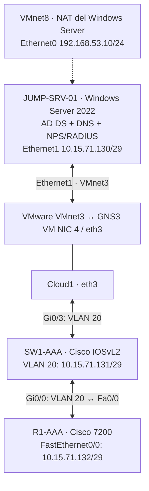
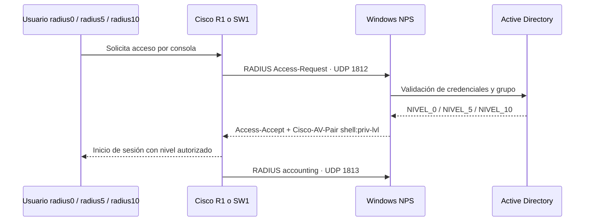

# Infraestructura AAA y RADIUS — Cisco + Windows Server 2022

**Estudiante:** Oliver Eliam Aquino Paulino  
**Matrícula:** 2024-1571  
**Asignatura:** Seguridad de Redes  
**Plataforma:** GNS3, Cisco 7200, Cisco IOSvL2, VMware Workstation, Windows Server 2022, Active Directory y NPS  
**Fecha:** 30 de octubre de 2026

## Descripción

Se implementó una infraestructura de autenticación, autorización y contabilidad (**AAA**) centralizada en Windows Server 2022 mediante **Network Policy Server (NPS)** como RADIUS. El router **R1-AAA** y el switch **SW1-AAA** utilizan el servidor para validar usuarios de Active Directory y recibir los niveles de privilegio **0, 5 y 10**. También se habilitó **SSH administrativo local** en los dos equipos Cisco.

Este repositorio replica la organización de [Infraestructura-DMZ](https://github.com/Oliverfa342/Infraestructura-DMZ): explicación, diagramas, running-configs sanitizados, configuración reproducible, comandos y pruebas.

## Objetivos

- Registrar R1 y SW1 como clientes del servidor RADIUS.
- Crear tres grupos y cuentas en Active Directory: `NIVEL_0`, `NIVEL_5` y `NIVEL_10`.
- Asociar tres directivas NPS con el atributo Cisco-AV-Pair `shell:priv-lvl=N`.
- Configurar listas AAA de autenticación, autorización EXEC y contabilidad.
- Proteger las líneas de **consola** y, cuando esté disponible, **auxiliar**; usar SSH con administradores locales como respaldo.
- Comprobar conectividad, respuestas RADIUS, privilegios y registros de seguridad.

## Topología

### Flujo lógico de autenticación

## Direccionamiento

| Equipo / conexión | Dirección | Propósito |
|---|---|---|
| Red AAA | `10.15.71.128/29` | Subred de administración |
| JUMP-SRV-01 · Ethernet1 | `10.15.71.130/29` | NPS + Active Directory · VMnet3 |
| SW1-AAA · VLAN 20 | `10.15.71.131/29` | Gestión Cisco y origen RADIUS |
| R1-AAA · FastEthernet0/0 | `10.15.71.132/29` | Enlace con SW1 y origen RADIUS |
| JUMP-SRV-01 · Ethernet0 | `192.168.53.10/24` | NAT VMware; gateway `192.168.53.2` |
| NPS | UDP `1812` / `1813` | Autenticación / contabilidad |
| Dominio | `redes.test` | AD DS |

**Conexión física GNS3 / VMware:** GNS3 VM Adaptador 4 = VMnet3 = `eth3`; Cloud1 `eth3` ↔ SW1 `Gi0/3`; SW1 `Gi0/0` ↔ R1 `Fa0/0`. Windows Server Adaptador 2 = VMnet3. Se conserva el adaptador NAT del servidor.

## Active Directory y NPS

| Usuario | Grupo AD | Directiva de red | Atributo RADIUS |
|---|---|---|---|
| `radius0` | `NIVEL_0` | `AAA-NIVEL-0` | `shell:priv-lvl=0` |
| `radius5` | `NIVEL_5` | `AAA-NIVEL-5` | `shell:priv-lvl=5` |
| `radius10` | `NIVEL_10` | `AAA-NIVEL-10` | `shell:priv-lvl=10` |

**Clientes RADIUS:** `R1-CISCO` = `10.15.71.132`; `SW1-CISCO` = `10.15.71.131`. Ambos se observaron habilitados en la consola de NPS. Las directivas usan pertenencia a grupo, autenticación PAP para el laboratorio aislado, `Service-Type = NAS-Prompt` y Cisco-AV-Pair. El registro NPS permite consultar los eventos `6272` (acceso concedido) y `6273` (acceso denegado).

**Más detalles:** [Windows Server, AD y NPS](scripts/WindowsServer_AD_NPS.md).

## Equipos Cisco

**R1-AAA:** conexión `Fa0/0` al switch, RADIUS tradicional `radius-server host`, origen `Fa0/0`, listas AAA aplicadas en `line con 0` y `line aux 0`. Las VTY usan autenticación y autorización **locales** por SSH con `adminlocal` (nivel 15).

**SW1-AAA:** `Gi0/0` y `Gi0/3` en VLAN 20, interfaz de gestión `Vlan20`; RADIUS mediante `radius server NPS-SW1`, origen `Vlan20`. VTY con SSH local para `oliver` (nivel 15), consola con listas AAA. No se debe afirmar que SW1 tiene auxiliar si no existe en `show line`.

## Pruebas evidenciadas

| Prueba | Resultado documentado |
|---|---|
| Enlaces en GNS3 y VMnet3 | Conectividad restablecida al usar Cloud1 `eth3` |
| Windows Server `10.15.71.130/29` | Captura de `ipconfig` |
| Clientes y políticas NPS | Capturas de clientes y tres directivas habilitadas |
| `radius0`, `radius5`, `radius10` desde R1 | `User successfully authenticated` y atributos 0/5/10 |
| `radius10` desde SW1 | `User successfully authenticated`, atributo nivel 10 |
| SSH administrativo R1 | Acceso `adminlocal`, privilegio 15, SSH v2 |
| SSH administrativo SW1 | Acceso `oliver`, privilegio 15 |
| NPS | Eventos 6272 y 6273 en Seguridad |
| Autorización en nueva consola | Configuración de listas documentada; la captura del nivel efectivo de cada sesión no figura completa en los extractos proporcionados |

**Importante:** el resultado `test aaa` confirma el atributo de NPS, pero por sí solo no comprueba que cada sesión aplique efectivamente el nivel de privilegio. Los resultados de configuración se separan de los resultados que muestran las capturas.

## Archivos

### Running-config entregados (sanitizados)

- [R1-AAA — extracto de show running-config](running-configs/R1-AAA_show_running-config_SANITIZADO.txt)
- [SW1-AAA — extracto de show running-config](running-configs/SW1-AAA_show_running-config_SANITIZADO.txt)

**Procedencia:** transcripciones reales proporcionadas por el estudiante el 30/10/2026. **Las salidas recibidas están truncadas al final**, especialmente SW1 tras `banner exec`. Se preservan todas las líneas recibidas salvo secretos/hashes redaccionados. NO son backups restaurables completos.

### Configuración y comandos de recuperación

- [R1-AAA — comandos de configuración](configs/R1-AAA_comandos_reconstruccion.txt)
- [SW1-AAA — comandos de configuración](configs/SW1-AAA_comandos_reconstruccion.txt)
- [Windows Server, AD y NPS](scripts/WindowsServer_AD_NPS.md)
- [Direccionamiento y cableado](scripts/Direccionamiento_y_Puertos_AAA.txt)
- [Comandos de pruebas y evidencias](scripts/Comandos_Pruebas_AAA_RADIUS.md)
- [Incidencias, correcciones y recuperación](scripts/Incidencias_y_Recuperacion.md)
- [Informe técnico y diagramas](docs/Informe_Tecnico_AAA_RADIUS.md)

## Seguridad y respaldos

El repositorio es **público**. Por eso se ocultan los hashes de `enable secret` / `username secret` y el secreto RADIUS de los archivos compartidos. No se publican contraseñas de AD, secretos NPS, archivos XML exportados de NPS ni respaldos completos con credenciales. Conserva esos archivos **fuera de GitHub**. Si una contraseña de laboratorio ya se hizo pública, cámbiala antes de reutilizar el entorno.

En Cisco, para persistir la configuración: `copy running-config startup-config` en **ambos** equipos. En VMware, apaga el servidor correctamente antes de apagar el host.

## Conclusión

La práctica demuestra la autenticación centralizada de R1 y SW1 mediante NPS y Active Directory, la devolución de privilegios Cisco 0/5/10, el acceso SSH administrativo local y el registro de eventos. La documentación incluye tanto las configuraciones observadas como las instrucciones utilizadas para recuperar el laboratorio tras un apagón.
