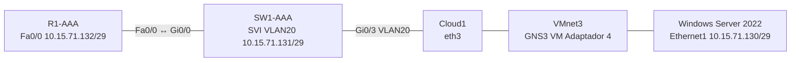
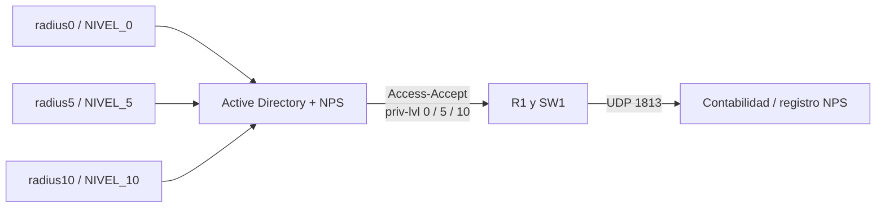

# Informe de infraestructura: AAA, RADIUS y NPS

**Oliver Eliam Aquino Paulino | Matrícula 2024-1571 | Seguridad de Redes | Octubre 2026**

## 1. Propósito y alcance

Configurar autenticación, autorización y contabilidad AAA en R1 y SW1 utilizando un servidor Windows Server 2022 con Active Directory y Microsoft NPS. Se asignaron tres niveles de privilegio 0, 5 y 10 a usuarios específicos del dominio; los administradores locales disponen de nivel 15 para acceso por SSH.

## 2. Diagrama físico

## 3. Diagrama lógico y AAA

## 4. Red y equipos

| Equipo | IP | Función |
|---|---|---|
| Windows NPS | 10.15.71.130/29 | AD DS, DNS, NPS |
| SW1 Vlan20 | 10.15.71.131/29 | Cliente RADIUS y gestión SSH |
| R1 Fa0/0 | 10.15.71.132/29 | Cliente RADIUS y gestión SSH |
| Windows NAT | 192.168.53.10/24 | Conectividad VMware host |

RADIUS usa UDP 1812 (autenticación) y UDP 1813 (cuentas). Windows no requiere gateway en Ethernet1 de VMnet3.

## 5. Active Directory y NPS

Los grupos `NIVEL_0`, `NIVEL_5`, `NIVEL_10` se asociaron a usuarios `radius0`, `radius5`, `radius10`. Las directivas `AAA-NIVEL-0/5/10` conceden acceso mediante PAP en este entorno aislado, usan `Service-Type = NAS-Prompt` y envían el atributo de Cisco `shell:priv-lvl=0/5/10` respectivamente. Los clientes NPS son `R1-CISCO` y `SW1-CISCO`.

## 6. Configuración Cisco

**R1:** autenticación `AAA-RADIUS group radius local`, autorización EXEC `AAA-RADIUS group radius local`, contabilidad `AAA-REGISTROS start-stop group radius`. `aaa authorization console` habilita autorización en consola; `line con 0` y `line aux 0` aplican listas de autenticación/autorización/contabilidad. Las VTY usan `VTY-LOCAL` y `VTY-AUTHZ` con SSH. Servidor RADIUS 10.15.71.130 y origen Fa0/0.

**SW1:** VLAN20 entre Gi0/0 y Gi0/3, SVI 10.15.71.131/29. NPS en `radius server NPS-SW1`, origen Vlan20. AAA de consola y SSH local para `oliver`. La salida compartida no incluye la sección completa de líneas de SW1, por lo que no se atribuyen configuraciones no mostradas a ese running-config.

Ver extractos sanitizados en `running-configs/` y comandos de reproducción en `configs/`.

## 7. Comprobaciones

- Windows `ipconfig`: confirma `10.15.71.130/29`.
- `ping` desde Cisco a NPS: conectividad comprobada.
- `test aaa` desde R1: `radius0`, `radius5`, `radius10` autenticados y reciben atributos 0/5/10.
- `test aaa` desde SW1: respuesta correcta con `radius10` nivel 10 y `radius0` nivel 0 en evidencias previas.
- SSH: R1 `adminlocal` y SW1 `oliver` mostraron nivel 15.
- `show aaa servers` / `show ip ssh`: servidores y SSH registrados.
- Eventos NPS 6272 y 6273: accesos concedidos y denegados.

**Límite de evidencia:** las capturas de `test aaa` demuestran los atributos del servidor, pero no sustituyen la prueba de una sesión nueva con `show privilege`. El conjunto compartido no acredita todos los niveles efectivos de las sesiones ni un auxiliar real de SW1.

## 8. Incidencias

El apagón ocasionó pérdida de configuraciones no persistidas. La recuperación requirió reconstruir Cisco, reconectar Cloud1 a `eth3`, habilitar cuentas AD, adaptar los dos dialectos RADIUS y actualizar la identidad SSH después de regenerar claves. El terminal Tera Term se configuró para pegar con retraso y evitar comandos concatenados.

## 9. Resultados y conclusión

La infraestructura demuestra una integración funcional de Active Directory, NPS y Cisco para autenticación centralizada con atributos de privilegio por grupo, además de acceso administrativo SSH y registros de seguridad. Se documentan explícitamente las pruebas mostradas y las configuraciones parciales que aún requerirían una exportación completa para ser restauradas fielmente. Al cerrar se recomienda `copy running-config startup-config` en los dos Cisco y un respaldo NPS privado.

---
**Anexo:** ver `scripts/Comandos_Pruebas_AAA_RADIUS.md` y `scripts/WindowsServer_AD_NPS.md`.
